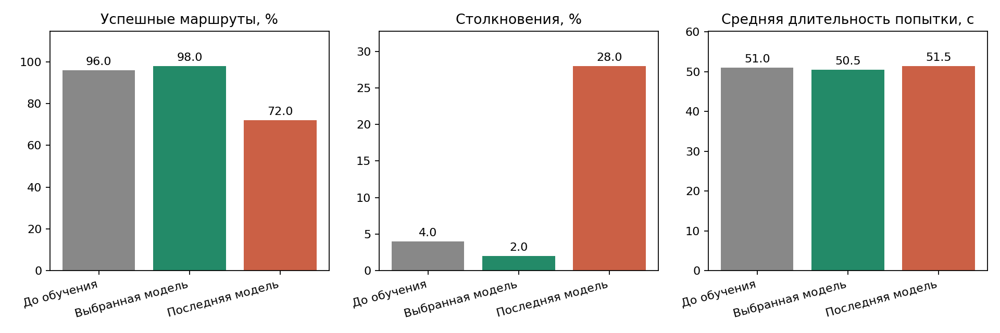
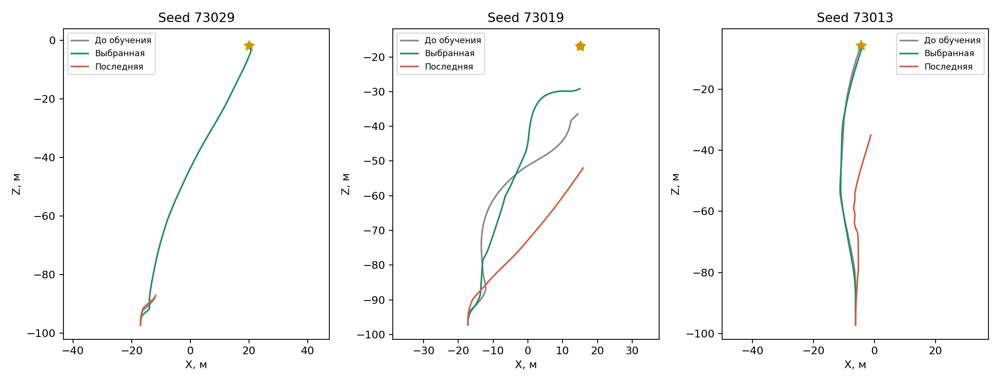

# GPS-навигация 50–100 м — отчёт за 21 октября 2026

**Выбранная модель прошла 49 из 50 независимых тестовых маршрутов с одним столкновением.** Критерий этапа — минимум 48/50 успехов и максимум одно столкновение — выполнен.

## Сравнение на одинаковых мирах

| Модель | Успехи | Столкновения | Таймауты | Средняя длительность попытки | Средняя награда |
|---|---:|---:|---:|---:|---:|
| До обучения | 48/50 | 2 | 0 | 51.01 с | 4.3676 |
| Выбранная модель | 49/50 | 1 | 0 | 50.46 с | 4.5073 |
| Последняя модель | 36/50 | 14 | 0 | 51.46 с | 3.5311 |

Выбрана контрольная точка **40,960 новых обучающих шагов**. Она выбиралась по отдельной валидации, до итоговой тестовой проверки. `latest.pt` соответствует шагу 100000 и существенно хуже. Средняя длительность включает неуспешные попытки.

## Условия и протокол

- Прежняя карта и физика; профиль `gps_50_100`, цели задаются на 50–100 м вперёд по Z. На извилистой дороге фактическое прямое GPS-расстояние может быть немного больше.
- Старт с известной ориентацией на север. Курс оценивается по GPS course и гироскопу. Датчики идеальные, без калиброванных ошибок и задержек.
- Физика 50 Гц, команды 10 Гц, лимит эпизода 240 с, радиус достижения цели 1 м.
- Предварительный перенос без обучения: seed 71001–71099, 48/50 успехов и два столкновения. Этот набор отличается от итогового теста.
- Валидация: 12 нечётных seed 72001–72023, примерно каждые 10000 действий. Выбор по успехам, затем столкновениям, затем награде.
- Итоговый тест: 50 нечётных seed 73001–73099, одинаковых для исходной, выбранной и последней моделей. Тестовые результаты не использовались для выбора контрольной точки. Обучающие миры имеют чётные seed.
- PPO продолжен с лучшей модели этапа 30–50 м; learning rate 1e-4, новый оптимизатор. Остальные параметры и формат наблюдений сохранены.

Завершено ровно **100000 новых обучающих действий**, 391 PPO-обновлений и 2894 обновлений оптимизатора. За обучение: 181/184 успешных эпизодов, 3 столкновения. Обучение с исходной, периодическими и итоговыми проверками заняло **69.02 минуты**; предварительный перенос в это время не входит.

## Траектории

Показаны восстановленные и неудачные маршруты с сопоставлением трёх моделей. Это диагностические примеры, а не дополнительный набор для выбора весов.

## Результаты по каждому тестовому миру

| Seed | До обучения | Выбранная модель | Последняя модель | Время выбранной, с |
|---|---|---|---|---:|
| 73001 | success | success | success | 58.42 |
| 73003 | success | success | success | 66.90 |
| 73005 | success | success | success | 37.60 |
| 73007 | success | success | success | 32.20 |
| 73009 | success | success | success | 59.34 |
| 73011 | success | success | success | 58.38 |
| 73013 | success | success | collision | 60.06 |
| 73015 | success | success | success | 69.02 |
| 73017 | success | success | success | 55.12 |
| 73019 | collision | collision | collision | 38.86 |
| 73021 | success | success | success | 53.80 |
| 73023 | success | success | collision | 55.52 |
| 73025 | success | success | success | 67.22 |
| 73027 | success | success | success | 64.54 |
| 73029 | collision | success | collision | 65.50 |
| 73031 | success | success | success | 62.60 |
| 73033 | success | success | collision | 58.20 |
| 73035 | success | success | success | 57.18 |
| 73037 | success | success | collision | 52.96 |
| 73039 | success | success | collision | 62.04 |
| 73041 | success | success | collision | 41.72 |
| 73043 | success | success | success | 56.14 |
| 73045 | success | success | success | 53.76 |
| 73047 | success | success | success | 60.06 |
| 73049 | success | success | success | 45.08 |
| 73051 | success | success | success | 39.34 |
| 73053 | success | success | success | 42.64 |
| 73055 | success | success | success | 44.04 |
| 73057 | success | success | success | 52.44 |
| 73059 | success | success | success | 64.62 |
| 73061 | success | success | success | 52.76 |
| 73063 | success | success | success | 52.48 |
| 73065 | success | success | success | 45.06 |
| 73067 | success | success | success | 44.00 |
| 73069 | success | success | collision | 44.48 |
| 73071 | success | success | collision | 40.58 |
| 73073 | success | success | success | 40.20 |
| 73075 | success | success | success | 40.82 |
| 73077 | success | success | success | 44.30 |
| 73079 | success | success | success | 43.20 |
| 73081 | success | success | success | 61.14 |
| 73083 | success | success | collision | 34.60 |
| 73085 | success | success | success | 38.24 |
| 73087 | success | success | collision | 55.56 |
| 73089 | success | success | success | 34.88 |
| 73091 | success | success | success | 47.64 |
| 73093 | success | success | collision | 46.70 |
| 73095 | success | success | collision | 47.22 |
| 73097 | success | success | success | 36.68 |
| 73099 | success | success | success | 37.06 |

## Проверка и происхождение артефактов

Все записанные потери/градиенты и веса последней модели конечны; аудит артефактов завершился успешно. SHA-256 выбранного `best.pt`: `6c4cd9b6800fcdd3f92f7adbcfed34ddfc37722d2104ee7e12b97493775cad71`.

SHA-256 Unity assembly: `db60cc820bd10cac74f9488ccbde905c7ee98f3525c742d14b8638309b585f5d`. Коммит Python-исходников на старте: `3f2294494444bf07d74bed02c3ddfb8bf9ac4325`. Контроллер дополнительно сохранил хеши всех Python-исходников и исходных весов.

Локальные артефакты исходной рабочей папки: `runs/gps_50_100_stage/best.pt`, `manifest.json`, `summary.json`, `training/summary.json`, `training/audit.json` и траектории. Веса, сборки, камеры и полные журналы не включены в Git. Здесь опубликованы отчёт, графики и компактная таблица результатов.

Результат относится к этому симулятору и 50 тестовым мирам. Один провал остаётся; другие стартовые направления, цепочки точек и перенос на реального робота этим экспериментом не проверялись. Этап 100–150 м не запускался.
