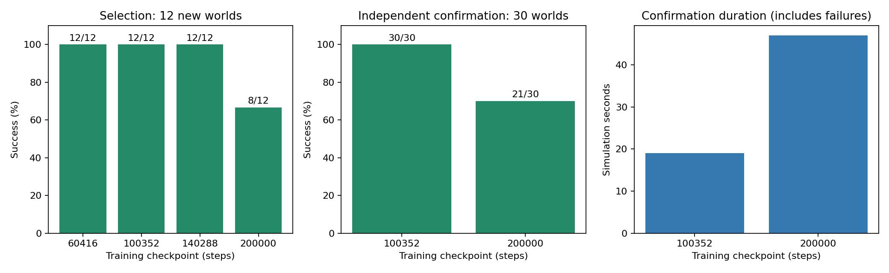
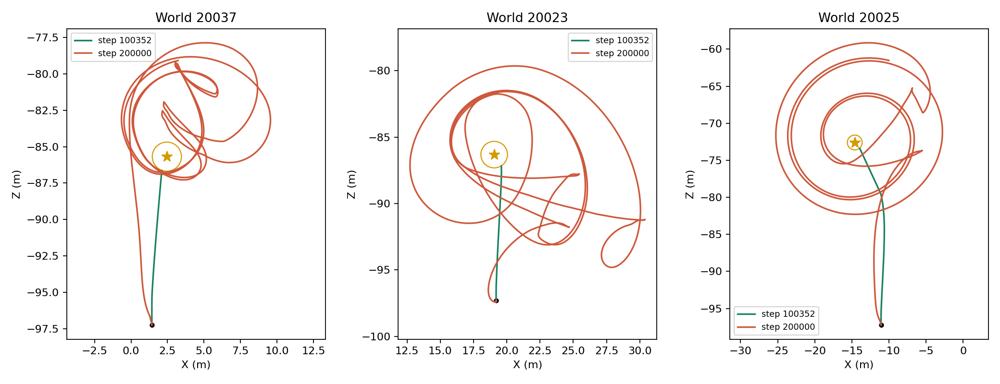

# GPS checkpoint investigation — 2026-10-21

The final model was worse than an earlier checkpoint. We froze the simulator and all policy weights, selected among four checkpoints on 12 new odd-seed worlds, then compared the selected model and final model on 30 other odd-seed worlds. The confirmation set was not used to select the checkpoint. No retraining was performed in this comparison.

| Phase | Training step | Successes | Collisions | Mean attempt duration, s |
|---|---:|---:|---:|---:|
| Selection | 60416 | 12/12 | 0 | 20.16 |
| Selection | 100352 | 12/12 | 0 | 15.23 |
| Selection | 140288 | 12/12 | 0 | 19.95 |
| Selection | 200000 | 8/12 | 2 | 42.33 |
| Independent confirmation | **100352** | **30/30** | **0** | **19.05** |
| Independent confirmation | 200000 | 21/30 | 4 | 46.98 |

Duration includes unsuccessful attempts and their 90 s timeout. Checkpoint selection prioritized success, then fewer collisions, then mean return. All three earlier models passed selection; step 100352 won its tie-break on return. The comparison ran 108 episodes in 497.5 seconds on the same graphics-enabled Unity player. These are simulator outcomes under known north-facing launch and ideal sensor measurements, not a deployment guarantee.

## Failure evidence

During training, success was 97.6% in steps 50000–100000 and 98.0% in 100000–150000, falling to 69.0% in 150000–200000. Approximate mean forward goal range stayed near 20 m across these bins. The paired frozen-checkpoint comparison establishes an actual policy regression rather than inferring one from training losses.

The final policy sometimes passes near the goal and continues circling. In the original fixed test world 2027, it traveled approximately 265 m from a 20.5 m starting distance, approached within 1.64 m in recorded samples and timed out. The independent worlds also show large loops for the final model where the earlier model reaches the goal. This identifies a control failure; trajectories alone do not establish whether heading estimation, speed choice or steering response is its root cause. Simulator tire/motor calibration remains unchanged.

## Changes to training

Version 0.2 validates periodically in a separate Unity process and retains `best.pt` using validation outcomes. A later worse update cannot replace it. Final testing uses separate seeds and evaluates both latest and selected best. CLI exposes learning rate, interval and seed sets. A 64-step integration test exercised initial and final validation; it correctly kept step 0 when step 64 was worse, and successfully evaluated the selected weights on a separate seed. It was a software test, not a new quality-training run.

The selected original weights are preserved in the original workspace at `runs/gps_checkpoint_benchmark/best.pt`, with model card, checksums, frozen evaluator sources, per-world traces, camera images, report and summaries. These artifacts are excluded from Git; this document and its plots summarize the evidence. Future training should initialize from the selected checkpoint and retain validation-based selection. Additional route length and sensor realism require new independent tests.

## Reproduce

Use `steppe-benchmark --help` (or `python -m steppe_robot.benchmark`) with the four original checkpoints, frozen simulator executable and fresh output directory. Selection seeds were odd values 10001–10023; confirmation seeds odd values 20001–20059. The original training seeds were even. `steppe-benchmark-report --run <directory>` renders the report, saves a byte-identical copy of the selected weights, and writes per-route path metrics.
